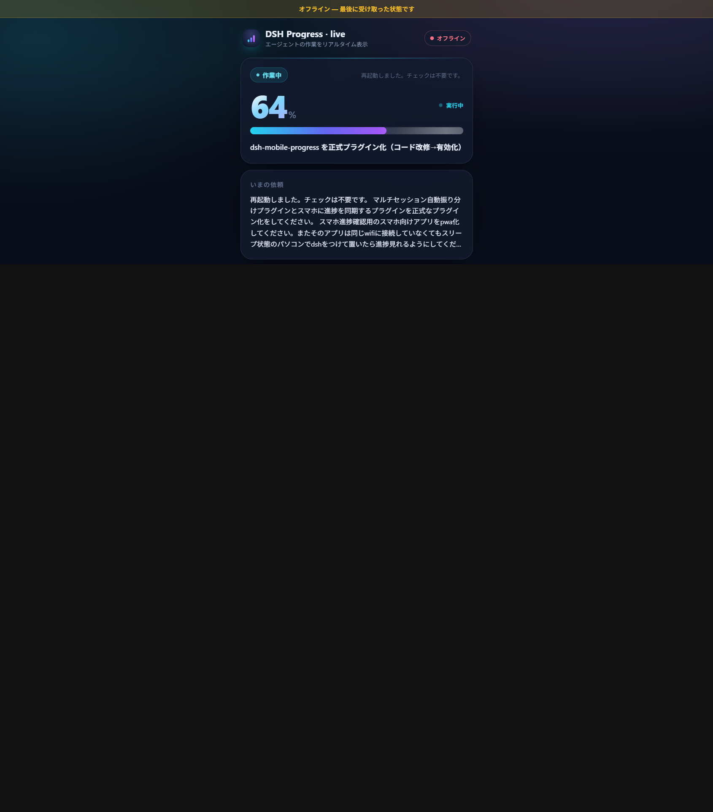

# dsh-mobile-progress

エージェントの進捗を、手元のスマホで「進捗バー」として見るための DeepSeek Harness プラグインです。
**同じ Wi-Fi にいなくても**見られます。PC がスリープで落ちないようにもします（実装は下記）。




- セッションの `todo_write` を自動でミラーするので、モデルが余計な作業をしなくてもバーが進みます。
- モデルは節目で `progress_update` を呼び、タイトル・ステップ・%・メモを明示できます。
- Host プラグインが小さな HTTP サーバーを立て、SSE で状態を配信します。
- 画面は**本物の PWA**（manifest + Service Worker + オフラインキャッシュ）。ホーム画面に追加すると
  ブラウザの枠なしで起動し、PC が止まっていても直前の状態を表示します。
- `cloudflared` トンネルを自動で張り、**インターネット越しの HTTPS URL** を発行します。
  スマホがモバイル回線・別 Wi-Fi でも、URL を知っていれば見られます。
- Windows のスリープを抑止するヘルパーを常駐させます（スリープした PC は応答できないため）。

```
session events ──► state fold ──► SSE ──► phone
   todo_write         (plugin)              ┌ 同一 Wi-Fi:  http://<LAN IP>:8790/?k=…
   progress_update                          └ どこからでも: https://<random>.trycloudflare.com/?k=…
```

## インストール

Plugin Manager でこのフォルダをバンドルとしてインストールします。

```
plugin_manager install_bundle  target: <このフォルダの絶対パス>
plugin_manager set_bundle      target: "@local/dsh-mobile-progress"  enabled: true
```

インストール直後に Host プラグインが有効になり、サーバーとトンネルが起動します。
`cordis.patch.yml` の値はプロファイル側の `cordis.patch.yml` で上書きできます。

> このプロファイルでは **有効化済み**（`enabled: true` / `application: applied`）です。
> 過去のメモにある「HMR が詰まって有効化できない」状態は解消しています。

## スマホで開く

`progress_status` ツール（または起動ログ）が 2 つの URL を返します。

| 種類 | 例 | 条件 |
|---|---|---|
| LAN | `http://192.168.1.32:8790/?k=…` | PC と同じ Wi-Fi。ファイアウォールで TCP 8790 を許可 |
| 公開 (HTTPS) | `https://epa-prep-chemicals-exhibits.trycloudflare.com/?k=…` | **何もいらない**。モバイル回線・別 Wi-Fi でも届く |

1. スマホのブラウザで公開 URL を開く（初回は cloudflared の取得で 1〜2 分かかることがあります）。
2. iOS Safari は「共有 → ホーム画面に追加」、Android Chrome は「メニュー → アプリをインストール」。
3. 以後はホーム画面のアイコンから、ブラウザ枠なしで起動します。

`?k=` はアクセストークンです。**URL ごとブックマーク/ホーム画面に保存**してください。

### うまく開けないとき

| 症状 | 原因と対処 |
|---|---|
| LAN URL が届かない | Windows ファイアウォール。下のコマンドで TCP 8790 を許可（Private） |
| 公開 URL が `530` | トンネルがまだ繋がっていない/落ちた。`progress_status` の `state.server.tunnel.status` を見る。数十秒待つと再接続します |
| 公開 URL が `401` | `?k=` が無い。URL をそのまま開き直す |
| 起動直後だけ `000` / 繋がらない | クイックトンネルは作成直後の数秒〜十数秒、エッジに未反映なことがあります。少し待って再読み込み |
| 画面が古いまま | Service Worker が古い版を持っている。再読み込みで自動更新（下記） |

```powershell
# 管理者 PowerShell（LAN で直接見る場合だけ必要）
New-NetFirewallRule -DisplayName "DSH Mobile Progress" -Direction Inbound `
  -Action Allow -Protocol TCP -LocalPort 8790 -Profile Private
```

> 公開 URL 経由ならトンネルは**外向き接続**なので、ファイアウォールも同じ Wi-Fi も不要です。

## 公開 URL（トンネル）

既定で有効です。初回起動時に `cloudflared` を GitHub Releases から
`~/.dsh/storages/mobile-progress/bin/` に自動で取ってきます（約 53 MB、1 回だけ）。

| モード | 設定 | 得られる URL |
|---|---|---|
| `quick`（既定） | なし。アカウント不要 | `https://<random>.trycloudflare.com`。**再起動ごとに変わる** |
| `named` | `tunnel.mode: named`, `tunnel.token: <tunnel token>`, `tunnel.publicHostname: progress.example.com` | 固定の独自ドメイン。Cloudflare アカウント＋ドメインが必要 |
| `custom` | `tunnel.mode: custom`, `tunnel.command: 'ngrok http {port}'` | 何でも。出力に `https://…` が出れば拾います |

`{port}` / `{url}` はコマンド内で置換されます。URL の検出は `trycloudflare.com` /
`ngrok*` / `*.ts.net` などの既知ドメインを優先し、GitHub 等の案内リンクは無視します。

**再起動で URL が変わるのが困る場合**は named トンネルにしてください（PC 再起動後も同じ URL）。
クイックトンネルは毎回 URL が変わるので、ホーム画面のアイコンはその都度作り直しになります。

## PC をスリープさせない（keep-awake）

スリープした PC は HTTP に応答できないので、進捗は見られません。そこでプラグインは
稼働中だけスリープを抑止します（既定 ON）。

- Windows: `SetThreadExecutionState(ES_CONTINUOUS | ES_SYSTEM_REQUIRED)` を
  呼び続ける小さな PowerShell ヘルパーを常駐（`keep-awake.ps1` を生成して `-File` 起動）。
  画面だけは消灯を許すので、夜間もパネルは焼けません（`keepDisplayOn: true` で画面も維持）。
- macOS: `caffeinate -i -s` / Linux: `systemd-inhibit`。

**これで防げないもの**: ノート PC の「ふたを閉じたらスリープ」。これは電源設定側の話なので、
管理者 PowerShell で明示的に変える必要があります。

```powershell
# ふたを閉じてもスリープしない（AC 給電時）。戻すときは 1 を指定
powercfg /setacvalueindex SCHEME_CURRENT SUB_BUTTONS LIDACTION 0
powercfg /setactive SCHEME_CURRENT
```

プラグインの `progress_status` の `state.server.keepAwake` で稼働状況（pid）を確認できます。

## セキュリティ

- **データはトークンで守ります。** `accessToken` が空でトンネルを張る場合、起動時に
  24 文字のトークンを生成し `~/.dsh/storages/mobile-progress/access-token`（0600）に保存します。
  以後の起動は同じトークンを使い回すので、URL は安定します。
- `/api/state` と `/api/stream` は `?k=<token>` か `x-progress-token` ヘッダーが必要（無ければ 401）。
- **アプリの外枠（HTML/CSS/JS/アイコン/manifest）は認証しません。** `<script src>` や
  `<link href>` はページのクエリ文字列を引き継がないため、ここを守ると画面自体が壊れます。
  シェルには進捗データが入っていません。
- 画面に出すのは**依頼文・ステップ・短いログ・カウンタ**だけ。アシスタント本文、ツール引数、
  ファイル内容は保存・配信しません（`todo_write` のステップ文字列は例外）。
- 公開 URL は「URL を知っていれば誰でも」届きます。トークン付き URL を人に見せないでください。
  漏れたら `access-token` ファイルを消して再起動すれば新しいトークンになります。

## モデル側の使い方

`progress_update`（任意のタイミング）:

```json
{
  "title": "ログイン画面の改修",
  "request": "ログインフォームのバリデーションを直して",
  "status": "working",
  "steps": [
    { "text": "現状のフォームを調査", "status": "done" },
    { "text": "バリデーションを実装", "status": "in_progress" },
    { "text": "テストを追加", "status": "pending" }
  ],
  "current_step": "バリデーションを実装中",
  "note": "既存テストが 1 件落ちているので後で直す"
}
```

`percent` を省略するとステップから自動計算します（done=1、in_progress=0.5）。
`todo_write` を呼ぶとステップ一覧と % は自動で同期されます。
最後は `status: "done"`、ブロック時は `status: "blocked"` と `note` を渡してください。

`progress_status` は現在の状態と、`phone_url`（LAN）・`public_url`（トンネル、無いときは空）を返します。
**スマホが別ネットワークなら `public_url` を渡してください。**

## 設定

| キー | 既定 | 意味 |
|---|---|---|
| `enabled` | `true` | プラグイン全体の有効化（false ならサーバーを立てない） |
| `port` | `8790` | 待受ポート。使用中なら +1 ずつ再試行 |
| `host` | `"0.0.0.0"` | `"127.0.0.1"` にすると PC 内だけに公開 |
| `accessToken` | `""` | 指定すると `?k=<token>` が必要（空＋トンネル時は自動生成） |
| `title` | `"DSH Progress"` | 画面タイトル |
| `autoClaim` | `true` | 最初に動いたルートセッションを自動で追跡 |
| `persist` | `true` | 状態を `~/.dsh/storages/mobile-progress/state.json` に保存 |
| `storeDir` | `~/.dsh/storages/mobile-progress` | 保存先（トークン・cloudflared・keep-awake もここ） |
| `maxLogs` | `40` | 保持するログ行数 |
| `tunnel` | `{ enabled: true, mode: "quick", autoDownload: true, requireToken: true }` | 公開 URL。`tunnel: false` で無効化 |
| `tunnel.provider` | `"cloudflared"` | 現在は cloudflared のみ |
| `tunnel.mode` | `"quick"` | `quick` / `named` / `custom` |
| `tunnel.token` | `""` | named モードの Tunnel トークン |
| `tunnel.publicHostname` | `""` | named モードで表示するホスト名 |
| `tunnel.command` | `""` | custom モードのコマンド（`{port}` / `{url}` 置換） |
| `tunnel.binaryPath` | `""` | 既存の cloudflared を指定（PATH → store の順で探すのも可） |
| `tunnel.autoDownload` | `true` | 無ければ取得する |
| `tunnel.requireToken` | `true` | 公開時にトークンを必須にする（false は非推奨） |
| `tunnel.maxRestarts` | `20` | トンネルが落ちたときの再起動回数 |
| `keepAwake` | `{ enabled: true, keepDisplayOn: false }` | スリープ抑止。`keepAwake: false` で無効 |
| `injectPrompt` 相当 | 常時 | システムプロンプトに使い方の節を足します（短い） |

`tunnel` は `false` の短縮形も受け付けます。

## HTTP API

| パス | 認証 | 内容 |
|---|---|---|
| `/` | なし | モバイル UI（シェル） |
| `/style.css`, `/app.js`, `/sw.js`, `/icon*`, `/manifest.webmanifest` | なし | PWA アセット（manifest は `start_url` にトークンを注入して生成） |
| `/api/state` | **必要** | 現在の JSON 状態 |
| `/api/stream` | **必要** | SSE（状態変更ごとに `data: {...}`、15 秒ごとに heartbeat） |
| `/healthz` | なし | 死活監視 |

## PWA の仕組み

- `manifest.webmanifest` はサーバー側で生成し、`start_url` / shortcuts に `?k=` を埋め込みます。
  こうしないと、ホーム画面から起動した瞬間に 401 になります。
- `sw.js` はアプリシェルをプリキャッシュし、`/api/state` は network-first + 直近の応答を
  `dsh-progress-data-*` に保存。`/api/stream` は絶対にキャッシュしません。
- キャッシュキーはクエリを落とした URL なので、`/?k=…` と `/` は同じエントリです。
- **トンネルが死ぬと Cloudflare は 502/530 を返します**（ネットワークエラーではない）。SW は
  非 2xx もキャッシュへフォールバックするので、PC が落ちていても最後の状態が出ます。
- 新しい `sw.js` を見つけると自動で有効化し、1 回だけ再読み込みします（初回設置時はリロードしません）。
- Service Worker は HTTPS / localhost でのみ動きます。LAN の HTTP では「ホーム画面ショートカット」
  として動き、オフラインキャッシュは効きません。

## 設計メモ

- セッションログは読み取り専用で購読し、新しいイベント種別は書き込みません（replay / fork 互換）。
- 進捗は派生キャッシュであり、真実はセッションログ側にあります。再起動後は保存された最後の
  状態を表示し、`stale` を立てます。
- トンネルは子プロセス。落ちたら指数バックオフで再起動し、`dispose` でプロセスツリーごと落とします
  （Windows は `taskkill /T /F`）。
- keep-awake を **インライン `-Command` で渡すとうまくいきません**。C# のシグネチャに含まれる
  ダブルクォートが再パースで壊れ、終了コード 1 で即死します。`keep-awake.ps1` を書いて
  `-File` で渡すのが正解です（実測で踏んだ罠）。
- 公開 URL が出るのは cloudflared の出力に URL が現れた瞬間だけ。準備前に URL を表示すると
  「開いても繋がらない」体験になるため、`status: running` までは `publicUrl` を空にしています。

## 検証済み（2026-11-17 / この PC）

- 単体テスト 20 本（`lib/tunnel.js` の URL 検出・トークン付与・PATH 探索・keep-awake 仕様・
  manifest ではなく純関数）が pass。
- 公開 URL 経由の実測: `/healthz` `/` `/api/state` `/sw.js` `/app.js` `/style.css` `/icon.svg` が
  すべて 200、`/api/state` トークン無しは 401。
- ブラウザ実測: `serviceWorker.getRegistration()` が scope 付きで active、`caches` に
  `dsh-progress-shell-v4` / `dsh-progress-data-v4`、SSE で `ライブ`、6 ステップを描画。
- オフライン実測: cloudflared とサーバーを停止（`curl` で 530 を確認）した状態で再読み込みしても、
  シェル・64%・7 ステップ・依頼文が表示され、「オフライン — 最後に受け取った状態です」が出た。
- keep-awake: プラグイン起動後に `powershell.exe` ヘルパーの pid が生存し続けることを確認
  （`powercfg /requests` は管理者権限が必要なので未確認）。

## 開発

```powershell
node --check index.js
node --check lib/tunnel.js
node --check public/app.js
node --check public/sw.js
node --test                      # 20 tests
```

Host を再起動せずに画面を確認したいときは、同じコードをモック Host で走らせるサイドカーが使えます。

```powershell
$env:DSH_MP_TUNNEL='1'; $env:DSH_MP_KEEPAWAKE='1'; node dev/sidecar.mjs
```

`public/` のファイルは実行時にそのまま配信されるので、編集後はスマホ側を再読み込みすれば反映されます
（Service Worker の版番号を上げると確実に更新されます）。

## 制限

- クイックトンネルは **URL が再起動ごとに変わります**。固定したいなら named トンネル。
- Cloudflare の無料クイックトンネルには可用性保証がありません。落ちたら自動再接続しますが、
  その間 URL は無効です。
- cloudflared の自動取得は Windows x64 / arm64 と Linux x64 / arm64 のみ。macOS は
  `brew install cloudflared` して `tunnel.binaryPath` を指定してください。
- ログイン付きの `?k=` は 1 本の共有秘密です。複数ユーザーで使い分ける設計ではありません。
