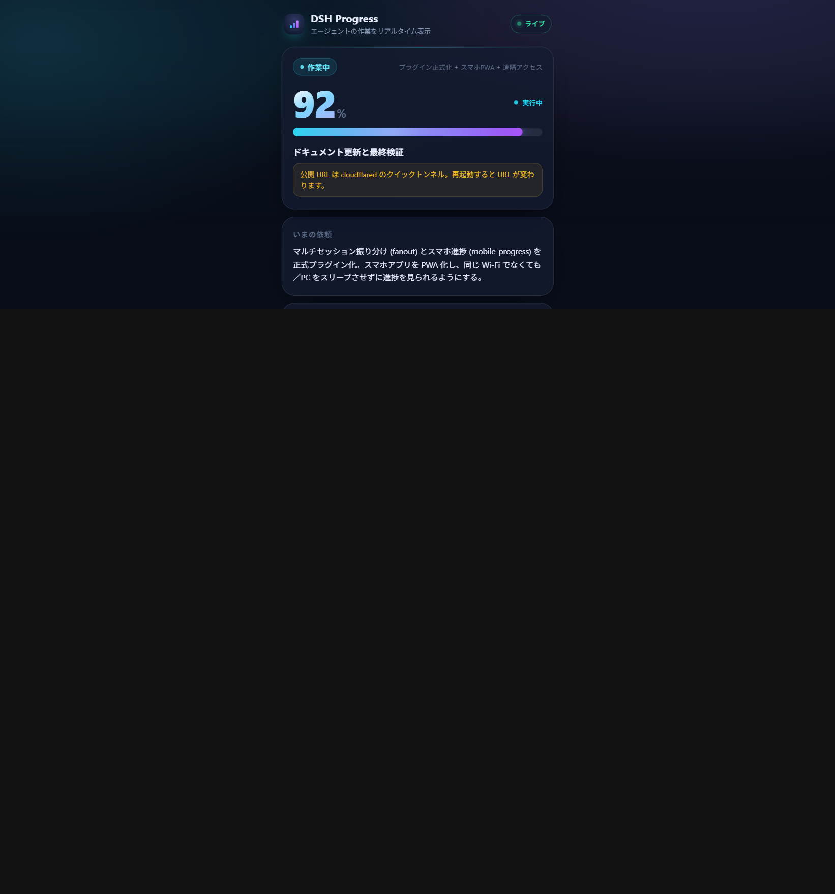

# dsh-mobile-progress

エージェントの進捗を、手元のスマホで「進捗バー」として見るための DeepSeek Harness プラグインです。
**同じ Wi-Fi にいなくても**見られます。v0.3.0 からは、スマホから**依頼を送って新しいセッションを
始め**、その進捗から**最終結果**までを同じ画面で追えます。PC がスリープで落ちないようにもします。




- セッションの `todo_write` を自動でミラーするので、モデルが余計な作業をしなくてもバーが進みます。
- モデルは節目で `progress_update` を呼び、タイトル・ステップ・%・メモを明示できます。
- Host プラグインが小さな HTTP サーバーを立て、SSE で状態を配信します。
- 画面は**本物の PWA**（manifest + Service Worker + オフラインキャッシュ）。ホーム画面に追加すると
  ブラウザの枠なしで起動し、PC が止まっていても直前の状態を表示します。
- `cloudflared` トンネルを自動で張り、**インターネット越しの HTTPS URL** を発行します。
  スマホがモバイル回線・別 Wi-Fi でも、URL を知っていれば見られます。
- Windows のスリープを抑止するヘルパーを常駐させます（スリープした PC は応答できないため）。
- **スマホから依頼を送って新しいセッションを開始**できます。ワークスペースを選んでプロンプトを
  送ると、そのワークスペースを `cwd` にして DSH のセッションが始まります。
- **進捗から最終結果までを同じ画面で**見られます。追跡中セッションの最後のアシスタント本文だけを
  折りたたんで表示します（推論・ツール内容は出しません）。

```
session events ──► state fold ──► SSE ──► phone
   todo_write         (plugin)              ┌ 同一 Wi-Fi:  http://<LAN IP>:8790/?k=…
   progress_update                          └ どこからでも: https://<random>.trycloudflare.com/?k=…
   assistant/message ──► result fold ──┘

phone ──► POST /api/session ──► sessionController.create() + prompt()
                                  └─► 新しいセッションが上の feed に流れ込む
```

## インストール

Plugin Manager でこのフォルダをバンドルとしてインストールします。

```
plugin_manager install_bundle  target: <このフォルダの絶対パス>
plugin_manager set_bundle      target: "@local/dsh-mobile-progress"  enabled: true
```

インストール直後に Host プラグインが有効になり、サーバーとトンネルが起動します。
`cordis.patch.yml` の値はプロファイル側の `cordis.patch.yml` で上書きできます。

> このプロファイルでは **有効化済み**（`enabled: true` / `application: applied`）です。
> 過去のメモにある「HMR が詰まって有効化できない」状態は解消しています。

## スマホで開く

`progress_status` ツール（または起動ログ）が 2 つの URL を返します。

| 種類 | 例 | 条件 |
|---|---|---|
| LAN | `http://192.168.1.32:8790/?k=…` | PC と同じ Wi-Fi。ファイアウォールで TCP 8790 を許可 |
| 公開 (HTTPS) | `https://epa-prep-chemicals-exhibits.trycloudflare.com/?k=…` | **何もいらない**。モバイル回線・別 Wi-Fi でも届く |

1. スマホのブラウザで公開 URL を開く（初回は cloudflared の取得で 1〜2 分かかることがあります）。
2. iOS Safari は「共有 → ホーム画面に追加」、Android Chrome は「メニュー → アプリをインストール」。
3. 以後はホーム画面のアイコンから、ブラウザ枠なしで起動します。

`?k=` はアクセストークンです。**URL ごとブックマーク/ホーム画面に保存**してください。

### うまく開けないとき

| 症状 | 原因と対処 |
|---|---|
| LAN URL が届かない | Windows ファイアウォール。下のコマンドで TCP 8790 を許可（Private） |
| 公開 URL が `530` | トンネルがまだ繋がっていない/落ちた。`progress_status` の `state.server.tunnel.status` を見る。数十秒待つと再接続します |
| 公開 URL が `401` | `?k=` が無い。URL をそのまま開き直す |
| 起動直後だけ `000` / 繋がらない | クイックトンネルは作成直後の数秒〜十数秒、エッジに未反映なことがあります。少し待って再読み込み |
| 画面が古いまま | Service Worker が古い版を持っている。再読み込みで自動更新（下記） |

```powershell
# 管理者 PowerShell（LAN で直接見る場合だけ必要）
New-NetFirewallRule -DisplayName "DSH Mobile Progress" -Direction Inbound `
  -Action Allow -Protocol TCP -LocalPort 8790 -Profile Private
```

> 公開 URL 経由ならトンネルは**外向き接続**なので、ファイアウォールも同じ Wi-Fi も不要です。

## スマホから依頼する（セッション開始）

PC の前にいなくても、思いついた依頼をそのまま投げられます。

1. 画面下の依頼パネルで**ワークスペース**を選ぶ（`GET /api/workspaces`）。一覧は DSH の
   ワークスペース台帳（既定 `~/.dsh/storages/workspace.json`、`control.workspacesFile` で変更）から読みます。
   セレクトに出す名前は**パスの最下層（フォルダ名）だけ**です。同じ名前が複数あるときは
   `名前（2）` のように番号を足し、フルパスは `title` 属性（PC のホバー）にだけ残します。
2. プロンプトを入力して**送信**する（`POST /api/session`）。上限は `control.maxPromptChars` 文字（既定 8000）。
3. サーバーが `ctx.get('sessionController')` でセッションを作り、`cwd` をそのワークスペースにして
   プロンプトを queue モードで流し込みます。
4. 以後そのセッションが**追跡対象**になり、進捗バー・ステップがライブで動きます。
5. ターンが終わると「最終結果」に**最後のアシスタント本文**が出ます（最大 `control.resultMaxChars` 文字。
   超えた分は切り、`truncated: true` になります）。

### fan-out を使う（スマホから）

依頼パネルの **fan-out（並列分解）** をオンにして送信すると、そのプロンプトの末尾に fan-out 指示が
追加されます。

- 指示文は、独立した作業が3つ以上あり並列に進められる依頼なら `fanout_start` で分解して実行し、
  `workers` / `expansion` を依頼に必要な値まで上げること、単一作業や直列の連鎖ならそのまま
  1セッションで処理して判断を1行で述べることを求めます。
- トグルは**次の1回だけ**有効です。送信に成功すると自動でオフに戻ります。
- 指示文もプロンプトの一部なので、`control.maxPromptChars` は指示込みで判定します（超過は送信前に
  画面が止めます）。
- これは Host 側 composer チェックボックスの「armed」状態そのものではありません。Host プラグインを
  再読み込みするとクイックトンネルの URL が変わってしまうため、**URL を保つ方式**として、armed の
  予算フロアや狭いグラフの拒否までは適用しません。それらが必要なときは PC 側のチェックボックスを
  使ってください。

成功時は `201` で `session.id` / `session.short` / `session.cwd` と、選んだ `workspace` を返します。
`GET /api/workspaces` の `control` は `{enabled, available, error}` で、「開始できる状態か」を画面に伝えます。

### 失敗したときの表示

| 状況 | 画面 | API |
|---|---|---|
| 送信先が未選択 | 「ワークスペースを選んでください」 | `400 workspace_required` |
| プロンプトが空 | 送信できない | `400 prompt_required` |
| プロンプトが長すぎる | 「長すぎます」と上限を表示 | `400 prompt_too_long` |
| 台帳に無いワークスペース | 「見つかりません。再読み込み」 | `400 workspace_not_found` |
| この Host では制御が無効 | 依頼パネルを出さない | `403 control_disabled` |
| `sessionController` が無い | 「この Host では開始できません」 | `503 session_control_unavailable` |
| セッションを開始できない（作成 or prompt 送信） | 「開始できませんでした。もう一度」 | `502 session_create_failed` |
| 送信中（二重送信） | ボタンを disable。成功で入力欄をクリア | — |
| トンネル断・オフライン | 「オフライン — 最後に受け取った状態です」 | fetch 失敗（画面は最後の状態） |
| body が 64KB 超 / JSON でない | 送信しない | `413 payload_too_large` / `415 unsupported_media_type` |
| body の JSON が壊れている | 送信しない | `400 invalid_json` |

進捗と結果は同じ SSE（`GET /api/stream`）に乗ります。`session.result` が `null` の間は
`session.resultState: "none"`、本文が入ると `"ready"` になります。

## 公開 URL（トンネル）

既定で有効です。初回起動時に `cloudflared` を GitHub Releases から
`~/.dsh/storages/mobile-progress/bin/` に自動で取ってきます（約 53 MB、1 回だけ）。

| モード | 設定 | 得られる URL |
|---|---|---|
| `quick`（既定） | なし。アカウント不要 | `https://<random>.trycloudflare.com`。**再起動ごとに変わる** |
| `named` | `tunnel.mode: named`, `tunnel.token: <tunnel token>`, `tunnel.publicHostname: progress.example.com` | 固定の独自ドメイン。Cloudflare アカウント＋ドメインが必要 |
| `custom` | `tunnel.mode: custom`, `tunnel.command: 'ngrok http {port}'` | 何でも。出力に `https://…` が出れば拾います |

`{port}` / `{url}` はコマンド内で置換されます。URL の検出は `trycloudflare.com` /
`ngrok*` / `*.ts.net` などの既知ドメインを優先し、GitHub 等の案内リンクは無視します。

**再起動で URL が変わるのが困る場合**は named トンネルにしてください（PC 再起動後も同じ URL）。
クイックトンネルは毎回 URL が変わるので、ホーム画面のアイコンはその都度作り直しになります。

## PC をスリープさせない（keep-awake）

スリープした PC は HTTP に応答できないので、進捗は見られません。そこでプラグインは
稼働中だけスリープを抑止します（既定 ON）。

- Windows: `SetThreadExecutionState(ES_CONTINUOUS | ES_SYSTEM_REQUIRED)` を
  呼び続ける小さな PowerShell ヘルパーを常駐（`keep-awake.ps1` を生成して `-File` 起動）。
  画面だけは消灯を許すので、夜間もパネルは焼けません（`keepDisplayOn: true` で画面も維持）。
- macOS: `caffeinate -i -s` / Linux: `systemd-inhibit`。

**これで防げないもの**: ノート PC の「ふたを閉じたらスリープ」。これは電源設定側の話なので、
管理者 PowerShell で明示的に変える必要があります。

```powershell
# ふたを閉じてもスリープしない（AC 給電時）。戻すときは 1 を指定
powercfg /setacvalueindex SCHEME_CURRENT SUB_BUTTONS LIDACTION 0
powercfg /setactive SCHEME_CURRENT
```

プラグインの `progress_status` の `state.server.keepAwake` で稼働状況（pid）を確認できます。

## セキュリティ

- **データはトークンで守ります。** `accessToken` が空でトンネルを張る場合、起動時に
  24 文字のトークンを生成し `~/.dsh/storages/mobile-progress/access-token`（0600）に保存します。
  以後の起動は同じトークンを使い回すので、URL は安定します。
- **`/api/` 配下はすべて** `?k=<token>` か `x-progress-token` ヘッダーが必要（無ければ 401）。
  対象は `/api/state`・`/api/stream`・`/api/workspaces`・`/api/session` です。
- **アプリの外枠（HTML/CSS/JS/アイコン/manifest）は認証しません。** `<script src>` や
  `<link href>` はページのクエリ文字列を引き継がないため、ここを守ると画面自体が壊れます。
  シェルには進捗データも結果本文も入っていません。
- 画面に出すのは**依頼文・ステップ・短いログ・カウンタ**、そして**追跡中セッションの最後の
  アシスタント text だけ**（最大 `control.resultMaxChars` 文字）です。推論（reasoning）、ツールの
  引数・結果、ファイル内容は**保存も配信もしません**。`assistant/message` の `text` ブロックだけを
  畳み、`user/message`（次の依頼）でクリアします。`todo_write` のステップ文字列は従来どおり例外です。
- **プロンプトは `control.maxPromptChars` 文字まで**、`POST /api/session` の body は 64KB まで。
  送信先は**ワークスペース台帳に載っている path のみ**で、それ以外は 400 `workspace_not_found`。
- 公開 URL は「URL を知っていれば誰でも」届きます。しかもトークン付き URL は**新しいセッションを
  開始する権限**になります（`/api/workspaces` はワークスペースの path も返します）。
  人に見せないでください。漏れたら `access-token` ファイルを消して再起動すれば新しいトークンになります。

## モデル側の使い方

`progress_update`（任意のタイミング）:

```json
{
  "title": "ログイン画面の改修",
  "request": "ログインフォームのバリデーションを直して",
  "status": "working",
  "steps": [
    { "text": "現状のフォームを調査", "status": "done" },
    { "text": "バリデーションを実装", "status": "in_progress" },
    { "text": "テストを追加", "status": "pending" }
  ],
  "current_step": "バリデーションを実装中",
  "note": "既存テストが 1 件落ちているので後で直す"
}
```

`percent` を省略するとステップから自動計算します（done=1、in_progress=0.5）。
`todo_write` を呼ぶとステップ一覧と % は自動で同期されます。
最後は `status: "done"`、ブロック時は `status: "blocked"` と `note` を渡してください。

`progress_status` は現在の状態と、`phone_url`（LAN）・`public_url`（トンネル、無いときは空）を返します。
**スマホが別ネットワークなら `public_url` を渡してください。**

## 設定

| キー | 既定 | 意味 |
|---|---|---|
| `enabled` | `true` | プラグイン全体の有効化（false ならサーバーを立てない） |
| `port` | `8790` | 待受ポート。使用中なら +1 ずつ再試行 |
| `host` | `"0.0.0.0"` | `"127.0.0.1"` にすると PC 内だけに公開 |
| `accessToken` | `""` | 指定すると `?k=<token>` が必要（空＋トンネル時は自動生成） |
| `title` | `"DSH Progress"` | 画面タイトル |
| `autoClaim` | `true` | 最初に動いたルートセッションを自動で追跡 |
| `persist` | `true` | 状態を `~/.dsh/storages/mobile-progress/state.json` に保存 |
| `storeDir` | `~/.dsh/storages/mobile-progress` | 保存先（トークン・cloudflared・keep-awake もここ） |
| `maxLogs` | `40` | 保持するログ行数 |
| `tunnel` | `{ enabled: true, mode: "quick", autoDownload: true, requireToken: true }` | 公開 URL。`tunnel: false` で無効化 |
| `tunnel.provider` | `"cloudflared"` | 現在は cloudflared のみ |
| `tunnel.mode` | `"quick"` | `quick` / `named` / `custom` |
| `tunnel.token` | `""` | named モードの Tunnel トークン |
| `tunnel.publicHostname` | `""` | named モードで表示するホスト名 |
| `tunnel.command` | `""` | custom モードのコマンド（`{port}` / `{url}` 置換） |
| `tunnel.binaryPath` | `""` | 既存の cloudflared を指定（PATH → store の順で探すのも可） |
| `tunnel.autoDownload` | `true` | 無ければ取得する |
| `tunnel.requireToken` | `true` | 公開時にトークンを必須にする（false は非推奨） |
| `tunnel.maxRestarts` | `20` | トンネルが落ちたときの再起動回数 |
| `keepAwake` | `{ enabled: true, keepDisplayOn: false }` | スリープ抑止。`keepAwake: false` で無効 |
| `control` | `{ enabled: true, workspacesFile: "", maxPromptChars: 8000, resultMaxChars: 4000 }` | スマホからのセッション開始と結果表示。`control: false` で無効 |
| `control.enabled` | `true` | false なら `POST /api/session` は 403 `control_disabled` |
| `control.workspacesFile` | `""` | ワークスペース台帳の JSON。空なら `~/.dsh/storages/workspace.json` |
| `control.maxPromptChars` | `8000` | 送れるプロンプトの最大文字数 |
| `control.resultMaxChars` | `4000` | 画面に出す最終結果の最大文字数（超えたら切る） |
| `injectPrompt` 相当 | 常時 | システムプロンプトに使い方の節を足します（短い） |

`tunnel` / `keepAwake` / `control` は `false` の短縮形も受け付けます。

## HTTP API

| パス | 認証 | 内容 |
|---|---|---|
| `/` | なし | モバイル UI（シェル） |
| `/style.css`, `/app.js`, `/sw.js`, `/icon*`, `/manifest.webmanifest` | なし | PWA アセット（manifest は `start_url` にトークンを注入して生成） |
| `/api/state` | **必要** | 現在の JSON 状態（`session.result` / `session.resultState` / `server.control` を含む） |
| `/api/stream` | **必要** | SSE（状態変更ごとに `data: {...}`、15 秒ごとに heartbeat） |
| `/api/workspaces` | **必要**（GET） | ワークスペース一覧 `{ok, workspaces[{id,title,path,updatedAt,sessionCount,exists}], control:{enabled,available,error}}` |
| `/api/session` | **必要**（POST, `application/json`, body ≤ 64KB） | プロンプトを送って新しいセッションを開始 |
| `/healthz` | なし | 死活監視 |

`/api/` 配下はすべて `?k=<token>` か `x-progress-token` が必要です（無ければ 401）。

### `POST /api/session`

```json
{ "workspaceId": "…", "prompt": "ログイン画面のバリデーションを直して" }
```

`workspaceId` の代わりに `cwd` を直接渡すこともできます（台帳に載っている path のみ）。
成功は `201` と `{ ok: true, session: { id, short, cwd }, workspace: { id, title, path } }`。

| ステータス / コード | 意味 |
|---|---|
| `400 prompt_required` | `prompt` が空 |
| `400 prompt_too_long` | `control.maxPromptChars` 超過 |
| `400 workspace_required` | `workspaceId` も `cwd` も無い |
| `400 workspace_not_found` | 台帳に無い path |
| `403 control_disabled` | `control.enabled: false` |
| `413 payload_too_large` | body が 64KB 超 |
| `415 unsupported_media_type` | `application/json` 以外 |
| `502 session_create_failed` | セッション作成に失敗 |
| `503 session_control_unavailable` | `sessionController` が取れない |

メソッドが違うと 405（`allow` ヘッダー付き）。台帳が読めないときも `GET /api/workspaces` は
200 で、空の一覧と `control.error` を返します（画面は「一覧を読めません」と表示）。

## PWA の仕組み

- `manifest.webmanifest` はサーバー側で生成し、`start_url` / shortcuts に `?k=` を埋め込みます。
  こうしないと、ホーム画面から起動した瞬間に 401 になります。
- `sw.js` はアプリシェルをプリキャッシュし、`/api/state` は network-first + 直近の応答を
  `dsh-progress-data-*` に保存。`/api/stream` は絶対にキャッシュしません。
- キャッシュキーはクエリを落とした URL なので、`/?k=…` と `/` は同じエントリです。
- **トンネルが死ぬと Cloudflare は 502/530 を返します**（ネットワークエラーではない）。SW は
  非 2xx もキャッシュへフォールバックするので、PC が落ちていても最後の状態が出ます。
- 新しい `sw.js` を見つけると自動で有効化し、1 回だけ再読み込みします（初回設置時はリロードしません）。
- Service Worker は HTTPS / localhost でのみ動きます。LAN の HTTP では「ホーム画面ショートカット」
  として動き、オフラインキャッシュは効きません。

## 設計メモ

- セッションログは読み取り専用で購読し、新しいイベント種別は書き込みません（replay / fork 互換）。
- 進捗は派生キャッシュであり、真実はセッションログ側にあります。再起動後は保存された最後の
  状態を表示し、`stale` を立てます。
- トンネルは子プロセス。落ちたら指数バックオフで再起動し、`dispose` でプロセスツリーごと落とします
  （Windows は `taskkill /T /F`）。
- keep-awake を **インライン `-Command` で渡すとうまくいきません**。C# のシグネチャに含まれる
  ダブルクォートが再パースで壊れ、終了コード 1 で即死します。`keep-awake.ps1` を書いて
  `-File` で渡すのが正解です（実測で踏んだ罠）。
- 公開 URL が出るのは cloudflared の出力に URL が現れた瞬間だけ。準備前に URL を表示すると
  「開いても繋がらない」体験になるため、`status: running` までは `publicUrl` を空にしています。
- 結果も派生キャッシュです。`assistant/message` の `text` ブロックを畳むだけで、真実はセッション
  ログ側にあります。`user/message` が来たらクリアします（前のターンの結果を残さない）。
- `sessionController` は起動時に必須にしません（無い環境でも進捗表示は動くべきなので）。
  `POST /api/session` のときだけ `ctx.get('sessionController')` を引き、無ければ 503 を返します。

## 検証済み（2026-11-17 / v0.2.0 時点・この PC）

以下は **v0.2.0 時点**の実測記録です（履歴として残します）。v0.3.0 の新機能の検証は統合後に追記します。

- 単体テスト 20 本（`lib/tunnel.js` の URL 検出・トークン付与・PATH 探索・keep-awake 仕様・
  manifest ではなく純関数）が pass。
- 公開 URL 経由の実測: `/healthz` `/` `/api/state` `/sw.js` `/app.js` `/style.css` `/icon.svg` が
  すべて 200、`/api/state` トークン無しは 401。
- ブラウザ実測: `serviceWorker.getRegistration()` が scope 付きで active、`caches` に
  `dsh-progress-shell-v4` / `dsh-progress-data-v4`、SSE で `ライブ`、6 ステップを描画。
- オフライン実測: cloudflared とサーバーを停止（`curl` で 530 を確認）した状態で再読み込みしても、
  シェル・64%・7 ステップ・依頼文が表示され、「オフライン — 最後に受け取った状態です」が出た。
- keep-awake: プラグイン起動後に `powershell.exe` ヘルパーの pid が生存し続けることを確認
  （`powercfg /requests` は管理者権限が必要なので未確認）。

## 開発

```powershell
node --check index.js
node --check lib/tunnel.js
node --check public/app.js
node --check public/sw.js

node --test                                  # test/ 配下をまとめて実行
node --test test/state.test.mjs              # ファイルを列挙して個別に回す例
```

テストは `test/` 配下にあります（`state.test.mjs` = 進捗 fold と純関数、`tunnel.test.mjs` =
トンネル設定と URL 検出、`workspaces.test.mjs` = 台帳・プロンプト検証・結果抽出、
`ui-contract.test.mjs` = 依頼パネルの要素 id・送信形・最下層表示・fan-out 指示・Service Worker 契約）。
v0.3.0 の残りのテスト（`/api/session` の HTTP・E2E）は統合時にこのフォルダへ追加されます。
本数は追加分で変わるので、README には書きません。

Host を再起動せずに画面を確認したいときは、同じコードをモック Host で走らせるサイドカーが使えます。

```powershell
$env:DSH_MP_TUNNEL='1'; $env:DSH_MP_KEEPAWAKE='1'; node dev/sidecar.mjs
```

`public/` のファイルは実行時にそのまま配信されるので、編集後はスマホ側を再読み込みすれば反映されます
（Service Worker の版番号を上げると確実に更新されます）。

v0.3.0 の新機能（`/api/workspaces`・`/api/session`・結果 fold・依頼パネル）の E2E は
**統合後に実行してここへ追記します**。この README には未実行の検証結果を書きません。

## 左サイドバーの「スマホ進捗」パネル（v0.4.0）

Web UI の左サイドバーに **スマホ進捗** の行が常駐します。アイコンを押すと、スマホで何を開けばよいかと、
いま何がどこまで進んでいるかが 1 画面で分かります。

| 表示 | 中身 |
|---|---|
| QR コード | スマホで読み取ると進捗ページがそのまま開く（トンネルが生きていれば公開 URL、なければ LAN URL） |
| 同じ Wi-Fi から / 外から（トンネル） | 実際の URL と「コピー」「開く」。`?k=` のトークン込み |
| いまの進み具合 | タイトル・%・現在の手順・手順リスト・直近の動き |
| メタ行 | 最終更新・ポート・セッション・トンネル状態・スリープ防止の有無 |

### 常駐の意味

- **クライアント側**: `dsh.client.immediately: true` でページ起動時に読み込まれ、`sidebar.panellist` に
  行を 1 つ登録します。アプリを閉じるまで消えません（パネルを開いていなくても行は残ります）。
- **ホスト側**: プラグインの `apply` で LAN サーバ・トンネル・スリープ防止が起動し、
  パネルを一度も開かなくてもスマホへの配信は続きます。
- パネル自体は 3 秒ごとに同じ状態を読み直すだけで、状態を持ちません（真実は常に Host 側）。

### データの経路

パネルは**同じオリジン**の JSON を読みます。スマホ配信の 8790 番とは別経路なので、
CORS もトークンも要らず、LAN 側の口を Web UI に露出しません。

```
GET /mobile-progress-api/state
  -> { ok, listening, port, phoneUrl, publicUrl, qrUrl, qr: { size, rows }, session, server, tunnel, keepAwake }
```

`qr` はモジュール行列（`'1'`/`'0'` の行文字列）で、ブラウザ側は受け取った行列を canvas に塗るだけです。
符号化は Host 側の `lib/qr.js` が行い、実体は MIT ライセンスの qrcode-generator 1.4.4
（`vendor/qrcode.cjs` にそのまま同梱）です。

### インストールと反映

```powershell
plugin_manager install_bundle  target: <このフォルダの絶対パス>
```

- **クライアント側（画面）は初回だけ再読み込みが要ります。** インストール後に Web UI を再読み込み
  （アプリなら Ctrl+R、またはアプリ再起動）すると、サイドバーに行が出ます。2 回目以降は起動のたびに自動で載ります。
- **ホスト側のコードを書き換えた場合**は ESM キャッシュが残るので、
  `plugin_manager set_plugin enabled:false` → `enabled:true`（entryId は `include:mobile-progress`）で
  新しい世代を読み込ませてください。

### 検証済みのこと

- `GET /mobile-progress-api/state` が 200 で `phoneUrl` / `publicUrl` / 41×41 の `qr` を返す（実機の DSH 上で確認）。
- QR は符号化 → ラスタライズ → jsQR 1.4.0 でデコードし、元の URL と一致することを確認
  （LAN URL・公開 URL・短い URL・長すぎて `null` になる場合）。
- `client.js` をページと同じ経路（`window.__ModuleLoader__.load`）で読み込み、`apply(ctx)` が
  `sidebar.panellist`（id `mobile-progress`）と `main`（key `mobile-progress`）を登録することを
  `test/client-registration.test.mjs` で固定。
- パネルとアイコンが DOM なしでも例外を投げずに描画されること、未接続時に案内文が出ること。

## 制限

- クイックトンネルは **URL が再起動ごとに変わります**。固定したいなら named トンネル。
- Cloudflare の無料クイックトンネルには可用性保証がありません。落ちたら自動再接続しますが、
  その間 URL は無効です。
- cloudflared の自動取得は Windows x64 / arm64 と Linux x64 / arm64 のみ。macOS は
  `brew install cloudflared` して `tunnel.binaryPath` を指定してください。
- ログイン付きの `?k=` は 1 本の共有秘密です。複数ユーザーで使い分ける設計ではありません。
- 追跡できるセッションは**同時 1 つ**です。`/api/session` で開始したセッションに切り替わります。
- `POST /api/session` は `cwd` ベースでセッションを作ります。モデル・エージェントプリセット・
  権限モードは指定できず、DSH の既定に従います。
